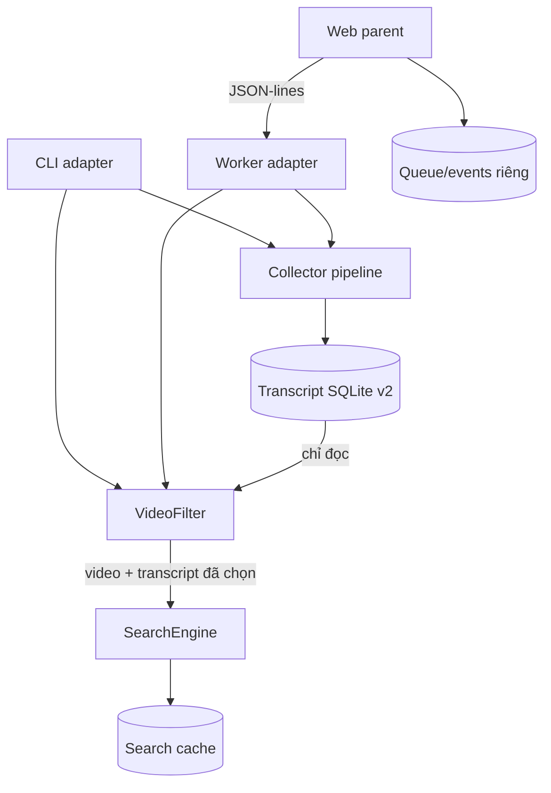

# Kiến trúc và hợp đồng

## Workspace và ranh giới

Workspace có năm project Python, cài editable vào **một `.venv` tại root**; chỉ
`uv.lock` ở root là nguồn khóa dependency. Root phụ thuộc cả năm member; các nhóm
mặc định `dev`, `whisper`, `gpu` giữ bộ công cụ phát triển và extra collector khi
chạy `uv run --locked`. `uv sync --all-extras` cài đầy đủ. `pyproject.toml` của các
member vẫn mô tả package, không tạo môi trường hoặc lock riêng.

| Thành phần | Trách nhiệm |
| --- | --- |
| `transcript_collector/src/transcript_collector` | yt-dlp, engine, pipeline collect và SQLite transcript |
| `video_search/src/video_search` | đọc corpus, lọc video, chia cửa sổ, mô hình/xếp hạng và search cache |
| `apps/cli/src/yt_cli` | parser, terminal, interactive, launcher và adapter điều phối |
| `apps/web/src/yt_web` | HTTP/UI local, queue/state, gateway và worker adapter |
| `apps/workflows/src/yt_workflows` | đánh giá đồng bộ và helper ứng dụng |

Hai core không import nhau hoặc ứng dụng; không có `service.py`, CLI, worker
transport, `print/input/SystemExit`, hoặc tự thay `os.environ`. Collector không gọi
embedding; search không gọi yt-dlp/Whisper, dù mọi dependency được cài cùng nơi.
Workflows không import UI, không argparse/print/exit hoặc đổi môi trường tiến trình.

CLI launcher dùng Python `.venv` root và argv rõ ràng, không dùng shell hoặc phân
tích output terminal. Các lệnh `yt collect/search` và alias
`yt-collect`, `yt-search` thuộc CLI; `yt-web` thuộc web. Subprocess
vẫn được giữ để quản lý vòng đời model, tín hiệu và protocol, cùng dùng Python root.



Điều phối và tài nguyên thuộc `yt_cli.collector_runtime.collect`,
`yt_cli.search_session.SearchSession` và các bản adapter riêng trong
`yt_web.workers`. Web không import CLI; parent web chỉ giao tiếp qua gateway,
không import core. Giữ factory `yt_web.create_app(collector=..., search=...)`,
`WebApplication`, `CollectorGateway` và `SearchGateway` để inject.

## Collector

Ứng dụng validate `config.CollectionRequest`, tạo `youtube.YouTube`, engine nếu
cần và `store.TranscriptStore`, rồi gọi `pipeline.index_video/index_channel/index_playlist`.
Ứng dụng đóng store trong mọi đường thoát; `CollectionResult` thuộc adapter.
Pipeline giữ cache, inventory, transaction và xử lý tuần tự theo từng video.

- Nhận URL video/playlist, `@handle`, URL kênh hoặc UC ID; không tìm ứng viên bằng
  tên kênh. URL video watch/youtu.be/shorts/live/embed được chuẩn hóa bỏ playlist và
  timestamp, lấy kênh sở hữu từ metadata, không liệt kê kênh.
- Kênh chỉ liệt kê tab `videos`, không `shorts/streams`. Playlist chỉ được định
  tuyến từ URL `/playlist`; yt-dlp xác thực/diễn giải URL và liệt kê native với
  `extract_flat=True`, `noplaylist=False`. Không tự phân trang/phân tích playlist ID.
  Video playlist giữ kênh sở hữu thật, không lưu bảng playlist.
- Inventory từng video commit sau khi có metadata và trước tải phụ đề/audio.
  Channel/playlist dùng cùng vòng lặp và gọi `index_video`. Metadata có sẵn được
  dùng lại; video đang/sắp livestream bị bỏ qua để tránh tải vô hạn.
- Chỉ dùng yt-dlp cho danh sách/phụ đề/audio; EJS/Deno là dependency liên quan.
  Xử lý tuần tự, Whisper/SQLite trên luồng gọi; không thread pool/`--workers` hoặc
  cờ giới hạn video. yt-dlp tối đa 2 fragment đồng thời, nghỉ 2 giây giữa yêu cầu
  trích xuất, tối đa 2 retry tải/trích xuất, timeout 20 giây; không bỏ fragment lỗi.
- Lỗi một video tiếp tục mục sau; HTTP 429/xác nhận bot dừng lượt chạy. Ctrl+C giữ
  transcript đã commit. Cookie chỉ áp dụng cho yt-dlp, không bảo đảm gỡ chặn.

### Mode, ngôn ngữ và engine

`direct` bắt buộc **một** `--language` (vi/en/en-US), không tải audio. Chọn manual
đúng ngôn ngữ → auto-generated gốc cùng ngôn ngữ → dịch tự động sang ngôn ngữ yêu
cầu; không có thì unavailable, không trả ngôn ngữ khác hoặc chuyển generate.
`en` chấp nhận `en-US`; `en-US` không lấy `en/en-GB`. Bật writeautomaticsub khi
trích xuất metadata để có cả bản dịch từ manual. Track dịch nhận ngôn ngữ đích
`tlang` từ URL, không dùng tên tổng hợp như `vi-en`; source=youtube,
source_mode=translated, language là ngôn ngữ đích.

`generate` không nhận `--language`: tải audio vào thư mục tạm rồi engine tự nhận
dạng. Engine hiện có Whisper, mặc định model medium; không thêm engine thực tế khi
chưa được yêu cầu. Không lưu audio/metadata audio/cache audio vào DB, không có
`--audio-dir`; dọn file sau thành công, lỗi và Ctrl+C. Cache được kiểm tra trước tải.

`TranscriptionEngine` có `name`, `config`, `transcript_language`, `transcript(audio)`;
factory ở `engines/__init__.py`, Whisper ở `engines/whisper.py`. `VideoSource` cung
cấp transcript/audio và `transcript_mode`; `ChannelSource` thêm danh sách video,
`PlaylistSource` thêm danh sách playlist/metadata video. Thêm engine không sửa
pipeline/storage. Hạ tầng ghi stdlib logging; sự kiện `CollectionEvent` qua callback
đồng bộ. Callback lỗi phát `EventDeliveryError`, không bị tính là lỗi nguồn.

## SQLite transcript: schema v2

`--db` mặc định `data/index.sqlite3`, `PRAGMA user_version=2`, FK, index và WAL.

```text
channels(id, title, url)
videos(id, channel_id, title, description)
transcripts(video_id, language, source, source_mode, config, updated_at)
transcript_parts(video_id, language, source, source_mode, position, start, duration, text)
```

- Khóa transcript `(video_id,language,source,source_mode)`; parts thêm `position`
  và FK tới đúng transcript. `language` là ngôn ngữ thật. `source` chỉ
  `youtube|generate`; mode YouTube `manual|auto_generated|translated|unknown`,
  mode generate là tên engine như `whisper`.
- `config` chỉ ở transcripts và dùng cho engine; direct mới ghi chuỗi rỗng.
  `updated_at` là UTC, thời gian segment tính bằng giây. Mỗi khóa giữ bản hiện hành,
  không có lịch sử, manifest hoặc audio_assets; không có `video.status` để search đọc.
- Ghi transcript+parts cùng transaction; refresh lỗi rollback giữ bản cũ và các
  ngôn ngữ/engine khác. Cache YouTube dựa vào video/source/ngôn ngữ khớp track,
  bỏ qua config cũ `vi,en`; cache generate dựa nguồn/engine/config phù hợp.
- Collector chỉ nâng schema đã biết v1→v2 nguyên tử, giữ nội dung: YouTube cũ có
  mode=unknown, engine cũ chuyển source=generate/mode=tên engine. Không đoán loại
  subtitle cũ, không migrate/xóa schema không nhận diện.
- Search mở input SQLite `mode=ro`, kiểm tra version và đủ cột; không migrate,
  tạo schema, ghi cache hoặc kết quả vào input. Fixture search tạo schema độc lập
  với triển khai collector. Input/cache/state/log/report phải khác nhau theo các
  cặp được bảo vệ, gồm symlink/hardlink và sidecars `-wal/-shm/-journal`.

## Lọc video và search

`VideoFilter.select(VideoFilters(...))` đọc snapshot SQLite, chọn một transcript có
nội dung cho mỗi video, trả `list[documents.VideoTranscript]`. Video/segment là
bất biến, mang metadata, cấu hình transcript và thời gian. Bộ lọc không tải model,
chia cửa sổ hoặc ghi search cache.

- Bộ lọc: kênh (ID/tên chính xác/URL canonical), ID video, ngôn ngữ, nguồn, mode.
  `video_ids=None` chọn tất cả; tuple/list rỗng chọn không video nào. Các ID OR với
  nhau rồi AND điều kiện khác; ID không phù hợp không mở rộng phạm vi.
- Mặc định vi/auto: YouTube manual → auto_generated → translated → unknown →
  generate/whisper. Chỉ tự dùng Whisper khi không chỉ định engine khác.
  Ngôn ngữ khớp chính xác hoặc biến thể vùng; ưu tiên loại nguồn/mode trước rồi mã
  ngôn ngữ chính xác. Không ghép transcript khác ngôn ngữ/mode. Đọc parts theo đủ
  khóa, thứ tự start/position, bỏ text rỗng. Không dựa video.status.

`SearchEngine(cache,...).search(query,videos,...)` chỉ tìm trên dữ liệu được truyền
vào, không giữ Corpus/kết nối transcript hoặc điều kiện lọc. Có thể đóng Corpus rồi
tìm trên snapshot; danh sách rỗng trả rỗng. `Corpus.windows` còn là adapter snapshot
cho workflows cũ, gọi bộ lọc và hàm chia cửa sổ thuần trong `documents`.

```python
from contextlib import closing
from video_search.cache import EmbeddingStore
from video_search.corpus import Corpus
from video_search.filtering import VideoFilter, VideoFilters
from video_search.search import SearchEngine

with closing(Corpus("data/index.sqlite3")) as corpus:
    videos = VideoFilter(corpus).select(VideoFilters(video_ids=("VIDEO_ID",)))
with closing(EmbeddingStore("data/search.sqlite3")) as cache:
    results = SearchEngine(cache).search("vai trò insulin", videos, moments_per_video=3)
```

Ứng dụng phải dùng cache khác input. `SearchSession` của mỗi ứng dụng kiểm tra
đường dẫn trước mở tài nguyên, giữ model/ma trận và đóng bằng context/`close()`.
Bộ lọc phát hiện commit collector qua `PRAGMA data_version`; cùng snapshot được
engine dùng lại. Tạo/gọi/đóng một session tuần tự trên cùng luồng sở hữu SQLite.

### Xếp hạng và nhiều đoạn

Cửa sổ khoảng 60 giây, bước khoảng 30 giây, bám thời gian segment; `end` có thể dài
hơn nếu segment kéo dài. Nội dung dài chia theo tokenizer (chồng tối đa 24 token):
MiniLM 128, model khác tối đa 512; lấy cosine cao nhất của các đoạn nhỏ, không cắt
mất phần cuối. Prefix query/document theo model. Batch mặc định 16.

| Chế độ | Nội dung và điểm |
| --- | --- |
| `hybrid` (mặc định) | Kết hợp BM25 FTS5 và cosine trên tiêu đề+transcript (MiniLM L12 mặc định) qua RRF, mặc định sắp xếp lại top ứng viên bằng mMARCO mMiniLM Cross-Encoder (`--no-rerank` để tắt) |
| `semantic` | Cosine trên tiêu đề+transcript (MiniLM L12 mặc định); model khác: e5-small/qwen3/jina-v5/embeddinggemma |
| `keyword` | BM25 FTS5 trên transcript+tiêu đề, yêu cầu đủ từ; `"cụm từ"` giữ thứ tự từ; không tải model/vector |
| `exact` | Khớp nguyên văn chuỗi con trên transcript+tiêu đề (giữ dấu tiếng Việt và dấu câu, không phân biệt hoa/thường); không tải model |

Keyword chuẩn hóa không dấu/chữ hoa/dấu câu (`NAD+` và `NAD` cùng token), không là
khớp chuỗi nguyên văn (khi cần khớp nguyên văn dùng `exact`). `similarity=null` ở
`keyword` và `exact`. `score` là RRF ở hybrid, cosine ở semantic, BM25 ở keyword,
điểm khớp ở exact (có thêm `rerank_score` khi bật rerank); không so điểm giữa
chế độ/model và không coi là xác suất đúng. `--min-similarity` dùng cho `hybrid` và
`semantic`, cần hiệu chỉnh riêng từng model; chưa có ngưỡng mặc định, nên câu ngoài kho
vẫn có thể nhận ứng viên. Search không tổng hợp câu trả lời.

Mặc định tối đa 3 đoạn/video, đổi bằng `--moments-per-video`; `--top` luôn giới hạn
video. Giữ cửa sổ điểm cao nhất trước, loại cửa sổ chồng lấn start/end thực với
đoạn đã giữ; khoảng chỉ chạm đầu/cuối được giữ riêng. Không gộp thành đoạn dài.
Video và `moments` xếp theo độ liên quan. Mỗi moment có start/end/text/url/score/
similarity; metadata transcript nằm ở video. Các trường top-level cũ vẫn trỏ đoạn
tốt nhất. Link mở đầu cửa sổ, có thể sớm hơn câu cần tìm.

## Cache và đánh giá

`data/search.sqlite3` là dữ liệu dẫn xuất: `embedding_vectors` lưu float32 nhị phân
khóa theo model/revision/cấu hình mã hóa/SHA-256 text; `token_splits` lưu cách chia.
`lexical_windows/lexical_rows/search_state` giữ FTS5 tăng dần theo phạm vi corpus:
thêm/thay/xóa/reposition cửa sổ khi cần. Bảng JSON `embeddings` cũ được giữ nhưng
không tái dùng vector có thể đã cắt input. Đổi chuẩn hóa/mã hóa phải tăng phiên bản
cache liên quan; không tự xóa cache/model để chữa lỗi.

Đánh giá giữ nguyên snapshot metadata v2 cho mọi model qua `prepare_windows`/
`search_windows`, mặc định một đoạn/video. Rerank chia theo ngân sách token cặp
query/document. Nhãn chưa đầy đủ và chưa được người dùng duyệt; tập con không chứng minh chất
lượng toàn kho. Xem [evaluation/README.md](evaluation/README.md) cho metric và cách chạy.

## Web, tiến trình và nhật ký

Web FastAPI/Uvicorn local, một server/process; giao diện có collect/search,
thư viện, tham số nâng cao và JSON. Gateway gọi worker JSON-lines bằng
Python root; model và SQLite ở worker. Queue/events ở `data/web.sqlite3`, không ghi
vào transcript/cache. Một chủ sở hữu state DB; queued tiếp tục sau restart,
running chuyển interrupted. Generate và phân tích dùng khóa model chung, đóng
search worker để nhường GPU; direct có thể chạy cùng search.

SIGINT/shutdown có thể xử lý phải dừng nhóm tiến trình và dọn audio tạm. Lỗi còn
biết từ E2E: SIGKILL server có thể để worker/audio tồn tại; restart không quản lý
worker cũ. Không khẳng định đã khắc phục nếu chưa có kiểm chứng mới.

Core chỉ phát stdlib log/callback; ứng dụng sở hữu handler/rotation/context. CLI
log `data/logs/cli.jsonl`; web `data/logs/web.jsonl` hoặc cạnh state DB đã đổi.
File DEBUG, console INFO mặc định, 5 MiB + 3 backups. Workflows cung cấp handler
khóa liên tiến trình cho ghi/rotation. Protocol log tách progress; không ghi log
vào DB nghiệp vụ, không log toàn query/transcript/vector/cookie/token; thông báo
credential/URL được che. Đường dẫn log và các bản xoay/khóa cũng được bảo vệ alias.

Chi tiết UI/API: [apps/web/README.md](apps/web/README.md).
